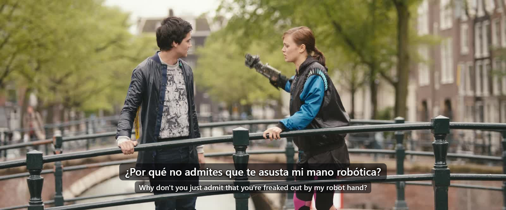
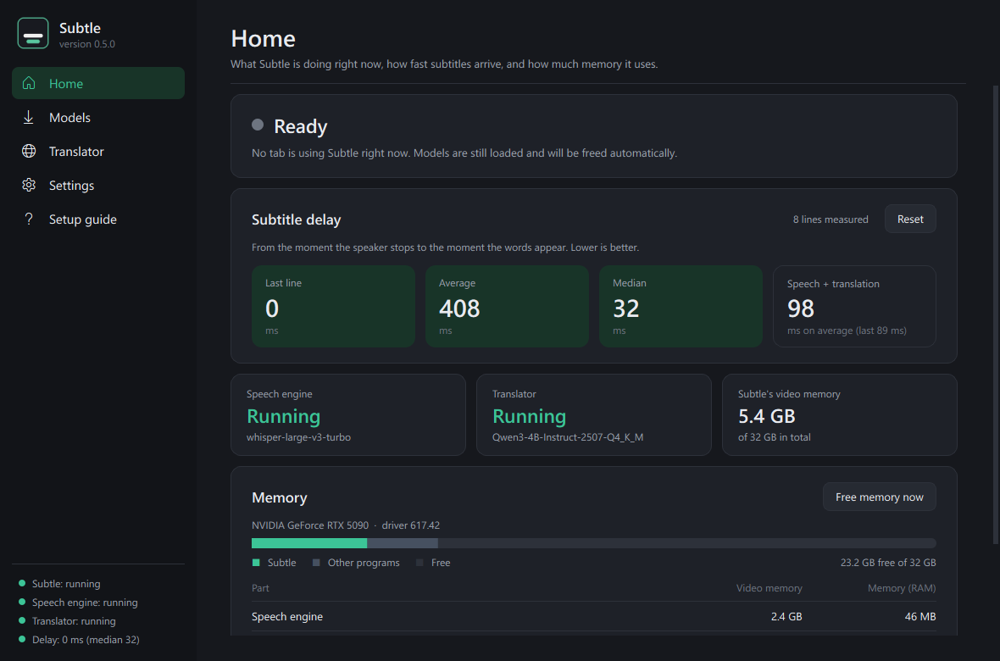
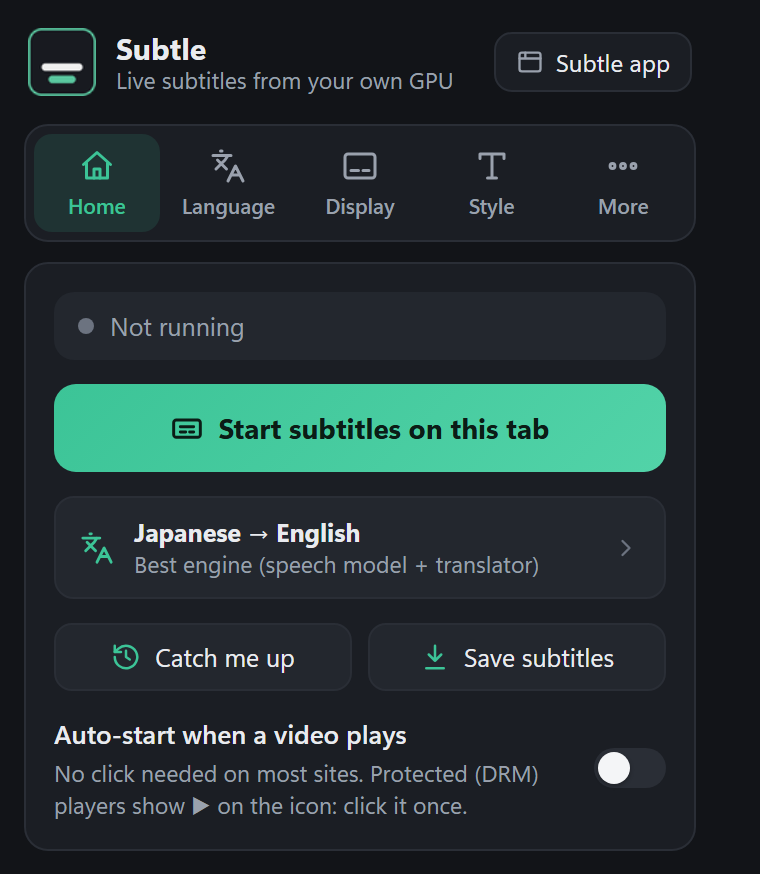
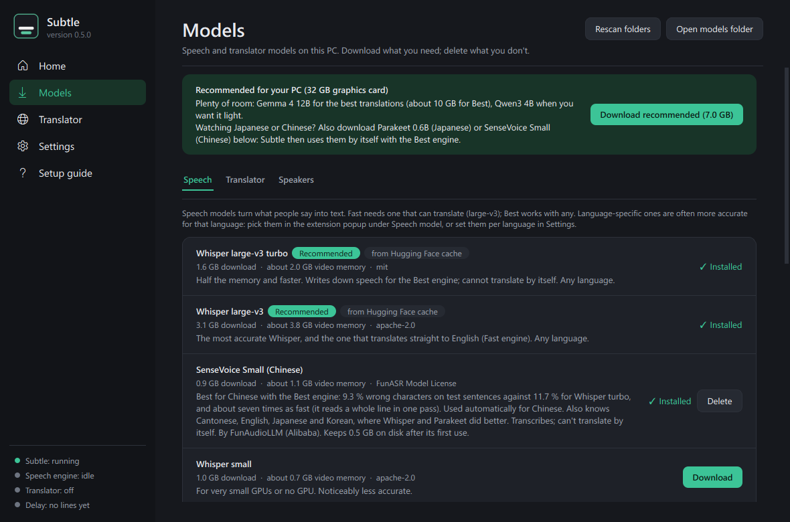
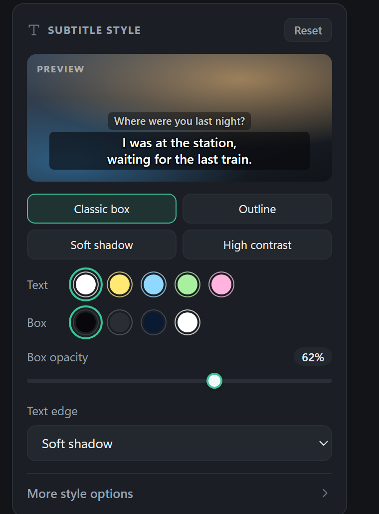

<p align="center">
  
</p>

<h1 align="center">Subtle</h1>

<p align="center">
  <b>Real-time subtitles and translation for any video in your browser, made on your own PC.</b><br>
  Free, private and offline: nothing you watch leaves your computer.
</p>

<p align="center">
  <a href="https://github.com/ddsaamir/subtle/releases/latest"></a>
  
  
  
  <a href="https://github.com/ddsaamir/subtle/actions/workflows/install-test.yml"></a>
  <a href="LICENSE"></a>
</p>

<p align="center">
  
  <br><sub>Real Subtle output: English speech turned into Spanish subtitles while the film plays, the original line underneath.
  Frame from <i>Tears of Steel</i>, (CC) Blender Foundation | mango.blender.org.</sub>
</p>

## What it does

- **Subtitles for any video on any website**: YouTube, streaming sites, anime, lectures, live streams.
- **Translates while you watch**: Japanese, Chinese, Korean and ~95 other languages into English
  (or into any language with the Best engine).
- **Fast**: a line appears about 0.2 s after the speaker stops.
- **Private**: speech recognition and translation both run on your own graphics card. No account, no
  cloud, no API keys.
- **Light**: uses no video memory until you start subtitles, and unloads by itself when you stop.
- **Easy**: one-click install, a normal Windows app to manage models, and a browser extension with a
  start button.
- **Subtitles for any app**: Discord, Zoom, games, VLC, a film on your PC. Subtle listens to what your
  speakers play and shows subtitles at the bottom of your screen.
- **Learning mode**: the original line with furigana or romaji (Japanese), pinyin (Chinese) or
  romanization (Korean). Click a word to see what it means; the video waits for you.
- **Save subtitles** as `.srt` or `.vtt` files that work in VLC and other players.
- **Catch me up**: missed something? A short summary of the last few minutes appears on the video.
- **Yours to arrange**: drag the subtitles anywhere on the video (remembered per site), hide them or
  show the last line again with a shortcut, and pick colours, box, outline and size.

## Examples

Real lines from Subtle (English film audio, Best engine, Spanish subtitles), with how long each took
after the speaker stopped:

| Heard (English) | Subtitle (Spanish) | Delay |
|---|---|---|
| Look, Celia, we have to follow our passion. | Mira, Celia, tenemos que seguir nuestra pasión. | 0.2 s |
| You have your robotics and I just want to be awesome in space. | Tienes tus robóticos y yo solo quiero ser genial en el espacio. | 0.2 s |
| Why don't you just admit that you're freaked out by my robot hand? | ¿Por qué no admites que te asusta mi mano robótica? | 0.2 s |
| It's not my fault, you know? | No es mi culpa, ¿sabes? | 0.2 s |
| Of course you're ready. You're a rock star. | Claro que estás listo. Eres una rock star. | 0.2 s |

## Screenshots

<table>
  <tr>
    <td width="62%"></td>
    <td></td>
  </tr>
  <tr>
    <td><b>Subtle app.</b> Status, subtitle delay in milliseconds, and exactly how much memory each part uses.</td>
    <td><b>Browser extension.</b> One button to start, pick the languages and the engine.</td>
  </tr>
  <tr>
    <td></td>
    <td></td>
  </tr>
  <tr>
    <td><b>Models.</b> Recommended models for your graphics card, downloaded with one click.</td>
    <td><b>Subtitle style.</b> Colours, box, outline and size, with a live preview.</td>
  </tr>
</table>

## Shortcuts

| Keys | What it does |
|---|---|
| **Alt+Shift+S** | Start or stop subtitles on the current tab |
| **Alt+Shift+H** | Hide or show the subtitles |
| **Alt+Shift+L** | Show the last line again |
| **Alt+Shift+U** | Catch me up: a short summary of the last few minutes |
| Drag a subtitle | Move the subtitles (remembered for that website); double-click puts them back |

You can change the keys at `chrome://extensions/shortcuts`.

## Subtitles for any app

For Discord, Zoom, games, VLC or a film on your PC (not in the browser): open the Subtle window, pick the
languages under **Subtitles for any app** on the Home page and press **Start**. Subtle listens to what
your speakers play and shows the subtitles at the bottom of your screen, on top of every window (clicks
go straight through them). Size, position, box and screen can be changed right there.

- **Only one program:** under *Listen to*, pick **Only Discord** (or any program that is playing sound)
  and Subtle hears just that program; music or videos elsewhere are left out. (Windows 10 version 2004
  or newer. *Refresh this list* shows programs that started playing later.)
- Games in exclusive fullscreen draw over everything: use borderless or windowed mode.
- If a browser tab is also subtitled, both get subtitles: stop one of them.

## How it works

```
video in a browser tab ─► Subtle extension ─► Subtle app on your PC ─► subtitles over the video
                                              ├─ Fast: Whisper translates straight to English
                                              └─ Best: a speech model writes the speech down, a built-in
                                                       translator model turns it into any language
```

---

## What you need

| | Minimum | Recommended |
|---|---|---|
| System | Windows 10 or 11 (64-bit), Linux (64-bit), or macOS on an Apple M-series Mac (Experimental) | Windows 11 |
| Browser | Any Chromium browser: **Chrome, Edge, Brave, Opera / Opera GX, Vivaldi**, Arc and others. **Firefox** works too (Experimental, see below). Not Safari | |
| Graphics card | NVIDIA GTX 16-series / RTX 20-series or newer, **6 GB** video memory | NVIDIA RTX 3060 / 4060 or better, **8 GB+** |
| Memory (RAM) | 8 GB | 16 GB |
| Disk | 8 GB + models (2-10 GB) | |
| Internet | only for the install and model downloads | |

- **Older NVIDIA cards (GTX 10-series)** work, but more slowly.
- **AMD and Intel graphics (Experimental)**:
  - **Linux + AMD:** speech and translation both run on the graphics card (ROCm).
  - **Windows + AMD or Intel, or Linux + Intel:** the translator runs on the graphics card (Vulkan), but
    speech recognition runs on the processor. Use the small or medium speech model and the Fast engine.
- **Apple M-series Macs (Experimental):** speech runs on the Apple GPU where it can, and the translator on
  Metal.
- **No graphics card:** Subtle still works on the processor, slowly. Use small models and Fast.
- Keep your NVIDIA driver reasonably up to date. The installer tells you if it's too old.

Experimental means it is installed and tested automatically on clean Linux and Mac machines with
every change (on the Mac, speech runs on its Apple GPU), but not yet used day to day on that hardware. If you have one, please try it and
[tell us how it went](https://github.com/ddsaamir/subtle/issues).

## Install (about 10 minutes)

### Windows

1. **[Download Subtle](https://github.com/ddsaamir/subtle/releases/latest)** from *Assets*:
   - **`Subtle-Setup-<version>.exe`**: double-click it. It asks where to put Subtle and installs it.
   - or **`Subtle-<version>.zip`**: unzip it somewhere with free space (e.g. `D:\Subtle`) and
     double-click **`Install Subtle.bat`**.
   - Want only the basics? Take **`Subtle-Lite-<version>.zip`**: just subtitles and translation for the
     browser, no extra features, about 260 MB smaller. (The full version can hide its extras too:
     **Settings → Simple mode**.)

   Either way, everything goes inside that one folder (a private Python, the translator engine), plus
   a **Subtle** shortcut on the desktop and in the Start menu. Nothing is installed system-wide.
2. The **Subtle window** opens. Follow its **Setup guide**:
   - **Download the recommended models.** It picks them for your graphics card, one click.
   - **Add the browser extension:** open `chrome://extensions` in your browser (this address works in
     Chrome, Edge, Brave, Opera and Vivaldi), turn on **Developer mode** (top right; in Edge it's on the
     left), click **Load unpacked**, and choose the `extension` folder inside Subtle.
     (The Setup guide has a button that copies the exact path.)
3. Open a video, click the Subtle icon in the browser toolbar, then **Start subtitles on this tab**
   (or press **Alt+Shift+S**).

From then on, just start **Subtle** from the desktop shortcut. Closing its window keeps it running
in the tray (bottom right, next to the clock). It uses no video memory until you turn subtitles on;
click the tray icon to open the window again. Want it always ready?
**Settings → Start Subtle when Windows starts.**

> Windows SmartScreen or your antivirus may ask about `Subtle-Setup.exe` or `Install Subtle.bat` the
> first time, because it's a new, unsigned download. The installer only downloads from GitHub (the
> `uv` Python manager and llama.cpp, both checksum-checked), PyTorch and PyPI (pinned package
> versions). Models come from Hugging Face at pinned versions and are checksum-checked too.

### Linux and macOS (Apple M-series)

1. Download **`Subtle-<version>.zip`** (or the Lite zip) and unzip it, e.g. into `~/Subtle`.
2. In a terminal, in that folder: `./install.sh` (it detects your graphics card; to choose yourself,
   use `./install.sh --gpu nvidia`, or `nvidia-old`, `amd`, `intel` or `cpu`).
3. Start Subtle: Linux: from your applications menu, or `./subtle.sh`. macOS: double-click
   **`Subtle.command`** in the Subtle folder.
4. Add the browser extension as on Windows (step 2 above).

Linux needs `curl` and, for the tray icon, an AppIndicator-capable desktop. *Subtitles for any app*
uses PulseAudio or PipeWire. On macOS the first start may need *System Settings → Privacy & Security →
Open anyway*, because the download is not signed.

### Firefox (Experimental)

Firefox can't record a whole tab like Chromium browsers can, so it subtitles the video on the page
itself. That works on YouTube and most players, but not on protected (DRM) sites such as Netflix.

1. Open `about:debugging#/runtime/this-firefox` and click **Load Temporary Add-on…**.
2. Choose `manifest.json` in the **`extension-firefox`** folder inside Subtle (or the
   `Subtle-Firefox-extension-<version>.zip` from the release).
3. Firefox removes temporary add-ons when it closes; a signed version for addons.mozilla.org is coming.

## Which models should I use?

The **Models** page and the Setup guide recommend a set for your graphics card automatically.

| Your graphics card | Speech (Whisper) | Translator (for Best) | Video memory in use |
|---|---|---|---|
| 4 GB | medium | - (use Fast) | ~2 GB |
| 6 GB | large-v3 + turbo | Qwen3.5 2B | Fast ~4.1 GB · Best ~4.3 GB |
| **8-11 GB (recommended)** | large-v3 + turbo | **Qwen3 4B Instruct 2507** | Fast ~4.1 GB · Best ~5.7 GB |
| 12-15 GB | large-v3 + turbo | Qwen3.5 9B | Best ~8.7 GB |
| 16 GB+ | large-v3 + turbo | Gemma 4 12B | Best ~10 GB |

And by spoken language (Subtle picks these by itself when they are installed):

| Spoken language | Fast | Best |
|---|---|---|
| Japanese | Whisper large-v3 | **Parakeet 0.6B** + translator |
| Chinese | Whisper large-v3 | **SenseVoice Small** + translator |
| Korean and every other language | Whisper large-v3 | Whisper large-v3 turbo + translator |

These come from our own benchmark ([`benchmarks/`](benchmarks/), 120 test sentences per language, cut into lines the way Subtle
cuts them; wrong characters, lower is better):

| | Japanese | Chinese | Korean | Speech step per line |
|---|---|---|---|---|
| Whisper large-v3 | 6.1 % | 10.5 % | 5.4 % | ~95 ms |
| Whisper large-v3 turbo | 7.0 % | 11.7 % | 6.3 % | ~40 ms |
| Parakeet 0.6B (Japanese) | 6.2 % | - | - | ~8 ms |
| SenseVoice Small | 11.7 % | 9.3 % | 9.4 % | ~6 ms |

The test sentences are read aloud (FLEURS), not film or anime dialogue, so treat the numbers as a
guide. With the Best engine the translator adds about 60 ms per line.

- **Fast** (Whisper only): straight to English, the least memory, about 70 ms per line.
- **Best** (Whisper + translator): more natural lines, uses the previous lines as context, and works
  for **any** subtitle language, at about 95 ms per line.
- **Japanese** with Best: download **Parakeet 0.6B (Japanese)** on the Models page and Subtle uses it
  by itself. It reads a whole line in one pass (about 8 ms instead of 43 ms for the speech step) and
  was a little more accurate than Whisper turbo on test sentences. Any other speech model can still
  be picked in the popup at any time.
- **Chinese** with Best: download **SenseVoice Small (Chinese)** and Subtle uses it by itself. It was
  clearly more accurate than Whisper turbo on Chinese test sentences (9.3 % against 11.7 % wrong
  characters) and takes about 6 ms instead of 40 ms for the speech step.
- Parakeet and SenseVoice only write speech down; they can't translate. So they are used where the
  translator follows (Best). With **Fast**, Subtle keeps Whisper large-v3, which translates by itself.
- **Settings → Speech model for each language** changes what "Auto" means for Chinese, Japanese,
  Korean and all other languages. A model picked in the popup still wins.
- You can add your own models. Put a Whisper model folder into `models\whisper\`, or any instruct
  `.gguf` file into `models\llm\`, then press **Rescan**. Models you already downloaded with
  **LM Studio** are found automatically, so there's no need to download them twice.

## How Subtle saves memory

Subtle only uses memory while you're actually watching something with subtitles:

| State | Video memory (VRAM) | Memory (RAM) |
|---|---|---|
| Waiting in the tray (window open or closed) | **0** | ~40 MB |
| Fast (Whisper large-v3) | ~4.1 GB | ~0.1 GB |
| Best (Whisper turbo + Qwen3 4B) | ~5.7 GB | ~0.15 GB |
| Best, Japanese (Parakeet + Qwen3 4B) | ~5.0 GB | ~0.15 GB |
| Best, Chinese (SenseVoice + Qwen3 4B) | ~4.8 GB | ~0.15 GB |

- Nothing is loaded until a tab starts subtitles. Starting takes about 3-5 seconds; the sentence
  being spoken meanwhile still gets its subtitle.
- The Subtle window is a plain Windows window (no browser inside), about 15 MB.
- Starting the speech engine takes about 1.5 GB of RAM for a moment. A few seconds after a model has
  loaded, the engine hands that start-up memory back to Windows and keeps about 50 MB in use.
- The speech model is loaded into exactly-sized blocks of video memory, without the gaps a normal
  load leaves behind (0.3-0.5 GB less).
- **Five minutes after the last subtitle everything is unloaded** (Settings → Memory: 1-30 minutes,
  or keep models loaded for instant starts). **Free memory now** on the Home page or in the tray
  menu does it at once.
- Only one speech model is in memory at a time, and the translator only runs for the Best engine.
- The translator is set up for subtitles: a small context and a compact 8-bit cache. That's about
  25% less video memory than a general chat setup.
- **Previews** (the line updating while someone speaks) are the main GPU work. Settings → Memory can
  make them less frequent, or turn them off.
- The Home page shows exactly how much video memory and RAM each part of Subtle is using.

## Privacy

- **Nothing you watch leaves your PC.** The extension only talks to the Subtle app on your PC
  (`127.0.0.1`). The Subtle window and its connection only work on this PC.
- **Subtitles live in memory.** No subtitle text or audio is written to disk, unless you turn on
  **Save transcripts** in the extension popup (one text file per session in `transcripts\`).
- **Speaker voiceprints** (Identify speakers, off by default) are kept in memory only.
- **Error log:** `logs\errors.log` keeps errors only, never subtitle text (about 1 MB at most).
- **Catch me up** summaries are made by the translator on your PC, from subtitles kept in memory.
- **Subtitles for any app** record what your speakers play only while it is switched on, and send it
  only to the speech engine on your PC. Nothing is saved.
- **Learning mode** word lookups are answered by the translator on your PC.
- **Saved subtitle files** (`.srt` / `.vtt`) are only made when you press Save subtitles.
- The internet is used only by `Install Subtle.bat`, the **Download** buttons on the Models page, and
  a daily check for new versions: Subtle asks GitHub for the newest version number and sends nothing
  else (turn it off in Settings → *Tell me about new versions*).

## Troubleshooting

| Problem | What to do |
|---|---|
| The popup says "Subtle isn't running" | Start **Subtle** from the desktop or Start-menu shortcut. Look for its icon in the tray. |
| The first subtitle takes a few seconds | Normal: models load when you start (3-5 s). After that lines take ~0.1 s. To skip it, turn on Settings → Keep models loaded. |
| "No translator model" | Download one on the **Models** page (Best needs a translator; Fast doesn't). |
| Netflix, Prime Video, Disney+... show nothing with Auto-start | DRM video can't be read from the page. Click the Subtle icon (or press Alt+Shift+S) to use tab capture instead. |
| Out of video memory / games stutter | Use Fast, pick a smaller translator, set Previews to "every second", or press **Free memory now**. |
| Installer: "NVIDIA driver too old" | Update it from [nvidia.com/drivers](https://www.nvidia.com/drivers) or the NVIDIA app, then run `Install Subtle.bat` again. |
| Anything else | Subtle window → Settings → **Show activity log**, and the install log in `logs\install.log`. |

**Update:** the Subtle window tells you when a new version is out. Replace the Subtle files with the new version (keep `models\`, `runtime\` and
`settings.json`), run `Install Subtle.bat` again, and reload the extension in `chrome://extensions`.

**Uninstall:** quit Subtle (tray icon → Quit), untick "Start with Windows" if you turned it on,
delete the Subtle folder and the two shortcuts, and remove the extension from the browser.

---

## Popup settings (browser extension)

| Setting | What it does |
|---|---|
| Spoken → Subtitles in | Source language (or auto-detect) and subtitle language |
| **Fast** / **Best** | See above |
| Speech model | Auto picks large-v3 for Fast and turbo for Best (with Best: Parakeet for Japanese and SenseVoice for Chinese, if installed; changeable in the Subtle window's Settings) |
| Translator | Any installed translator; the default is set on the Translator page of the Subtle window |
| Show original-language line | With Best, shows the transcribed original under the translation |
| Identify speakers | Gives each voice its own colour (26 MB voiceprint model, Models page) |
| Auto-start when a video plays | Subtitles start by themselves on any tab where a video plays with sound (not for DRM video) |
| Catch me up | Shows a short summary of the last few minutes on the video (uses the translator model) |
| Save subtitles | Saves this video's subtitles as `.srt` or `.vtt`, with the original line too if *Original-language line* is on |
| Learning mode | Shows the original line with readings (furigana or romaji, pinyin, romanization). Click a word for its meaning. Needs the Best engine |

## For developers

| Part | File | Job |
|---|---|---|
| Supervisor | `server/supervisor.py` | Always-on app (no torch, ~40 MB with its window): tray, relays tabs to the engine, starts and stops the engine and translator, idle unload |
| Window | `server/ui_qt.py`, `server/tray.py` | The Subtle window (Qt; `ui.py` is a Tkinter fallback) and tray icon; they talk to the supervisor in-process |
| Engine | `server/server.py`, `engines.py`, `whisper_core.py`, `parakeet_core.py`, `sensevoice_core.py` | VAD segmentation, previews and finished lines. Whisper, Parakeet and SenseVoice are loaded and run by Subtle's own code (no transformers, NeMo or FunASR): CUDA graphs on the GPU, eager on the CPU. Started on demand by the supervisor |
| Translator | `server/llm_runner.py`, `llm_client.py` | Runs `bin/llama/llama-server.exe`; any OpenAI-compatible server works as "external" |
| Models | `server/modelstore.py`, `downloads.py`, `models/catalog.json` | Finds models (models/, HF cache, LM Studio); pinned, checksummed downloads |
| Extension | `extension/` | Captures tab audio and draws the overlay |
| Installer | `Install Subtle.bat`, `installer/` | uv + private Python, pinned packages (`requirements.txt`), pinned llama.cpp build (`versions.json`) |

Testing:

```
python server\smoke_test.py
python server\supervisor.py --no-window --no-tray --port 8799
python server\test_client.py clip.f32 --url ws://127.0.0.1:8799 --language ja
python server\test_client.py clip.f32 --url ws://127.0.0.1:8799 --mode llm --target fr
```

Through the supervisor, the engine and translator start by themselves. `server.py --verbose` runs
the engine alone (it then accepts extension origins on port 8765 itself). `clip.f32` is 16 kHz mono float32 PCM
(`ffmpeg -i clip.mp4 -ac 1 -ar 16000 -f f32le clip.f32`).

## Licenses

Subtle's code is MIT-licensed (see `LICENSE`). Models are downloaded from their authors on Hugging Face under their
own licenses, shown on the Models page:
- Whisper large-v3, medium, small (OpenAI): Apache-2.0; Whisper large-v3 turbo (OpenAI): MIT
- Parakeet-TDT-CTC 0.6B ja (NVIDIA): CC-BY-4.0
- SenseVoice Small (FunAudioLLM, Alibaba): FunASR Model License (see its model page)
- Kotoba-Whisper v2.0 and Bilingual v1.0 (Kotoba Technologies): Apache-2.0
- Anime-Whisper (litagin): MIT
- Qwen3 and Qwen3.5 (Alibaba Cloud): Apache-2.0
- Gemma 4 (Google): Apache-2.0
- WeSpeaker ResNet34 voiceprints (WeSpeaker): CC-BY-4.0

Subtle also uses llama.cpp (MIT) for the translator, Silero VAD (MIT) to hear when someone speaks,
and PyTorch (BSD-3-Clause). The benchmark numbers above were measured on the FLEURS test set
(Google, CC-BY-4.0); scripts and full results are in [`benchmarks/`](benchmarks/).

The demo image and example lines use *Tears of Steel* by the Blender Foundation
(mango.blender.org), CC BY 3.0.

## Changelog

See [CHANGELOG.md](CHANGELOG.md).
